# Fonoestratonika · OSC · MIDI

**Español** · [English](#english)

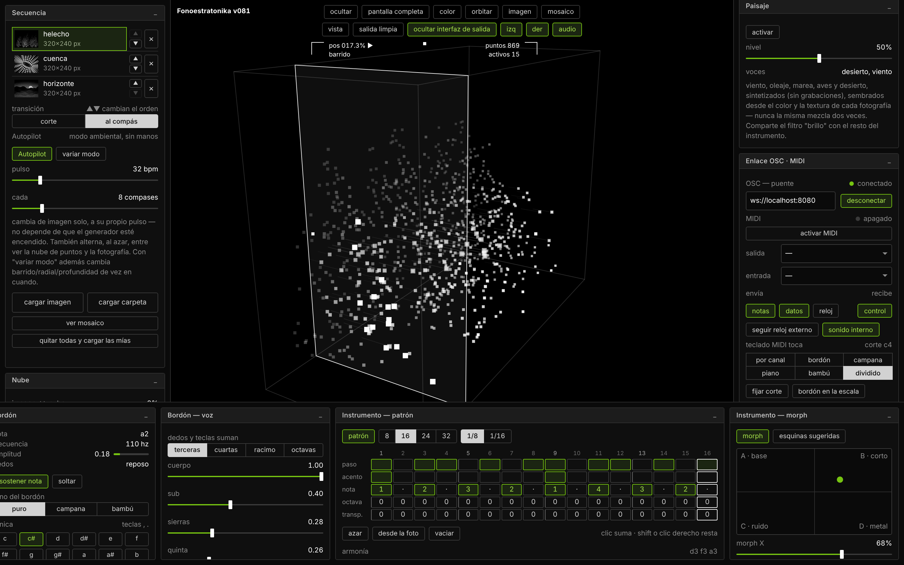

> **Variante instrumento.** Este repo es la versión de Fonoestratonika pensada para que un músico la toque en vivo (morph XY, armonía desde el teclado, patrón tipo arpegiador y set de MIDI en archivo). Parte de la v080 de [loquellega/fonoestratonika](https://github.com/loquellega/fonoestratonika). Idea impulsada por Maximiliano Wille.

Artefacto web de la colección **Alchemy of Meaning (Alquimia del Significado)**. Convierte fotografías en una nube de puntos en 3D y la lee con un barrido que genera sonido: luminosidad, bordes, color y posición se traducen en notas, timbres, un bordón continuo y un espectro visible. Puede funcionar solo (Autopilot) como instalación permanente, o tocarse como instrumento con el tacto, un teclado MIDI o desde Isadora y TouchDesigner por OSC.

Se estrenó en el simposio Baja Rare, dedicado a la flora rara y endémica de la península, en Loreto, Baja California Sur.

## Cómo funciona

**1. La foto se vuelve datos.** Cada imagen se reduce a una cuadrícula de unos 120 × 80 puntos. De cada punto se mide la luz, la fuerza de sus bordes y su color. De la imagen entera salen cinco rasgos: tono dominante, saturación, luz media, contraste y cantidad de bordes. Con esos cinco números se arma una **semilla**: la misma foto produce siempre la misma música.

**2. La nube y el barrido.** Los puntos con luz se elevan en profundidad según su brillo y forman la nube. Un plano recorre la nube de lado a lado, en anillo desde el centro o en profundidad. Lo que toca se reparte en 24 bandas, de grave a agudo, que suenan como un colchón aditivo continuo. Los bordes bajo el plano suman ruido filtrado.

**3. Las notas procedurales.** El generador no depende del barrido: tiene su propio reloj y la foto decide cómo es ese reloj.
- **Tonalidad:** el tono de color elige la tónica entre las 12 notas. La luz elige la escala: con poca saturación, tonos enteros; muy oscura, frigia; oscura, pentatónica menor; media, dórica; clara, pentatónica mayor.
- **Progresión:** la semilla genera 4 acordes, con saltos de 1 a 5 grados en la escala. El contraste decide si los saltos tienden a ser cortos o largos.
- **Tempo:** sale de los bordes. Una foto lisa va a unos 40 bpm y una muy texturada a unos 110. Cada paso es una corchea y 8 pasos forman un compás. Al inicio de cada compás el piano toca la fundamental del acorde.
- **Qué punto suena:** en cada paso se elige un punto de la imagen con una secuencia basada en la proporción áurea. Así se va recorriendo toda la foto sin repetirse y sin amontonarse.
- **Si suena o calla:** la probabilidad sube con la luz del punto, con el tiempo fuerte (pasos 1 y 5) y con la densidad. Cada cuatro compases hay uno con menos notas, como una respiración.
- **Timbre y altura:** un punto en un borde suena como bambú. Si no está en un borde, en la mitad alta suena como campana y en la baja como piano. La altura es una nota del acorde actual, más aguda cuanto más arriba esté el punto. La velocidad depende de la luz del punto y el paneo de su posición horizontal.
- **Misterio:** de vez en cuando aparece una nota de tensión, una segunda menor o un tritono. Lo hace más seguido en fotos oscuras y siempre en campana.

Los tres timbres se sintetizan en vivo, sin grabaciones. La campana usa parciales inarmónicos con cola larga, el piano usa FM suave con golpe de martillo y el bambú una ráfaga de ruido con resonador afinado.

**Clavos (v080).** Idea de Maximiliano Wille. Las 88 teclas del piano se reparten en partes iguales entre los puntos de la foto. Cuando suena una nota, del generador, del teclado o del bordón, sus puntos suben hacia el frente con una línea fina, crecen y se encienden, como los tableros de clavos que toman el molde de una mano. Hay tres repartos:
- **altura:** grave abajo, agudo arriba.
- **luz:** grave en lo oscuro, agudo en lo claro.
- **disperso:** cada tecla salpicada por toda la imagen.

En altura y luz cada nota también empuja un poco a sus vecinas, como la presión de un dedo. Las campanas duran más que el piano y el bambú, y el bordón sostiene sus clavos mientras suena. Se ajusta en la ventana **Nube**: clavos, reparto, altura del clavo y cola. «Marcas» vuelve a mostrar los círculos de antes.

**4. El bordón.** Es una voz sostenida de siete osciladores: cuerpo, sub, sierras desafinadas, quinta y octava, pasados por un filtro que respira con un LFO lento. Se toca sobre la imagen: la altura va en vertical y el volumen y el brillo en horizontal. Cada dedo extra suma un grado (terceras, cuartas, racimo u octavas). También se toca con teclado MIDI, hasta 4 notas a la vez. La ventana **Bordón — voz** abre toda su mezcla, el filtro, la respiración, el ataque y la caída.

**5. Paisaje.** Una capa opcional de viento, oleaje, marea, aves y desierto, también sintetizada. Se siembra desde el color y la textura de cada foto: los azules traen agua, los verdes aves y los cálidos desierto.

**6. Película.** Las fotos pasan por un tratamiento blanco y negro estilo HP5, con grano, contraste y viñeta ajustables. El análisis se hace sobre esa versión.

## Uso

1. Abre `index.html` en el navegador (o la versión en línea) y pulsa **sonar**. Eso activa el audio y entra en modo edición, con todas las ventanas.
2. Controles: ventanas laterales (secuencia, análisis, espectro, partitura, enlace) y dock inferior (control, sonido, generador, bordón, voz del bordón).
3. Teclas útiles: `espacio` sonar/detener, `h` ocultar la interfaz, `f` pantalla completa, `←` `→` cambiar de foto, `g` generador, `m` modo de barrido.
4. **Autopilot** viene activo: alterna imágenes y modos sin intervención.

### Tus fotos

Copia tus `.jpg`/`.png` a la carpeta `fotos/`, y en `fotos/listado.txt` escribe un nombre por línea (las líneas con `#` se ignoran). Si la lista está vacía, la app usa 3 imágenes de muestra. El botón «quitar todas y cargar las mías» sustituye la galería actual.

### Teclado MIDI y controladores (v079)

En Chrome o Edge, ventana **Enlace OSC · MIDI** → **activar MIDI**, y elige tu teclado como entrada.
- **Dividido** (por defecto): abajo de do 4 tocas el bordón; arriba, bambú, piano y campana por octavas. «fijar corte» mueve la división.
- **Bordón polifónico:** hasta 4 notas sostenidas, en afinación libre o ajustadas a la escala.
- **Expresión:** el pedal sostiene, el pitch bend da ±2 semitonos y el aftertouch abre el filtro.
- **Perillas:** el mapa por defecto sigue General MIDI (1 filtro, 71 resonancia, 72 caída, 73 ataque, 74 brillo, 91 reverb). Con **aprender**, tocas un deslizador y mueves cualquier perilla para asignarla.

### OSC (Isadora, TouchDesigner, Max) (v078)

Fonoestratonika envía sus notas, el bordón, el barrido y los rasgos de cada foto, y recibe control y reloj. El navegador no habla UDP, así que OSC pasa por un puente pequeño sin dependencias (Node.js 18+):

```
node puente/puente.js --out 127.0.0.1:1234 --in 9001
```

Luego abre `http://localhost:8080`. El puente sirve la app y acepta varios destinos, por ejemplo una IP de Tailscale para tocar a distancia. El mapa completo de direcciones, CC y canales está en [`puente/LEEME.md`](puente/LEEME.md).

### Modo instrumento (v081)

Pensado para que un músico, como Maximiliano Wille, toque Fonoestratonika en una función. Inspirado en el Easy/Morph, el arpegiador y la tabla de controladores de FM8. Son dos ventanas nuevas en el dock:

**Instrumento — morph.** Un pad XY con cuatro esquinas. Cada esquina guarda un sonido: la voz del bordón, densidad, tempo, misterio, brillo, ruido de bordes, reverb, nube y clavos. El punto los mezcla. «Esquinas sugeridas» crea cuatro variantes del sonido actual (base, corto, ruido y metal) y los botones A–D guardan el sonido actual en una esquina. X e Y responden a los CC 18 y 19, a MIDI learn y a OSC (`/fono/mx`, `/fono/my`, `/fono/corner 0–3`, `/fono/morph 1/0`).

**Instrumento — patrón.**
- **El teclado manda:** abajo del corte (o en todo el teclado si no está en «dividido») tocas un acorde y el generador improvisa o arpegia sobre esas notas en lugar de la armonía de la foto. Sin teclas, espera, como un arpegiador. *Hold* deja sonar el acorde al soltar, *key sync* reinicia el patrón con cada acorde nuevo y «también al bordón» manda el acorde al bordón.
- **Patrón:** de 8 a 32 pasos en 1/8 o 1/16, con filas de paso, acento, nota (1–4 del acorde, o «·» para que decida la foto), octava (−2 a +2) y transposición (0–11). Clic suma; shift o clic derecho resta. «Azar», «desde la foto» y «vaciar». El timbre, el paneo y la luz siguen saliendo de la foto.
- **Tempo fijo:** de 30 a 200 bpm. Abajo de 30 se usa el tempo de la foto. Con 1/16, el reloj MIDI de entrada y salida va a 6 pulsos por paso.
- OSC: `/fono/harm`, `/fono/hold`, `/fono/hnote nota vel` (vel 0 suelta), `/fono/hclear`, `/fono/pat`, `/fono/patLen`, `/fono/bpmFix`.

**La nube escucha (v082).** El sonido transforma la nube, no solo la enciende:
- **Reparto «teclado»:** las 88 teclas van de izquierda (grave) a derecha (agudo), como un piano visto de frente. Se suma a los repartos por altura, luz y disperso.
- **Ejes:** la velocity empuja los clavos hacia el frente (eje Z), la intensidad los eleva mientras suenan (eje Y; deslizador «elevación»), el pitch bend los desvía hacia los lados y el aftertouch los ilumina.
- **Subestructuras por timbre:** la campana abre anillos, el bambú se desgrana en polvo, el piano queda nítido y el bordón respira al ritmo de su LFO.
- **Brillo y reverb:** el brillo vuelve los clavos más granulares (más subpuntos) y la reverb los dispersa más lejos.
- La nube sigue en blanco: la intensidad se expresa en luz, no en color. Se apaga con «la nube escucha» y «subestructuras» en la ventana **Nube**, o por OSC con `/fono/listen` y `/fono/pinSub`.

**Armonía (v083).** Cuando suenan varias notas juntas, la nube responde a la relación entre ellas:
- Las zonas de las notas se unen con líneas.
- Si consuenan (octavas, quintas, terceras), la línea es firme y las zonas se recogen.
- Si chocan (segundas, tritono), las zonas se abren, tiemblan y la línea se vuelve punteada.
- La tensión armónica, de 0 a 1, sale por OSC (`/fono/tension`) y por el CC 34 del canal 5.
- **Color por nota** (opcional, apagado por defecto): cada clase de altura toma un color del círculo de quintas.

Se ajusta con «armonía» y «color por nota» en la ventana **Nube**, o por `/fono/pinHarm` y `/fono/pinColor`.

**Ondas (v084).** Idea de Maximiliano Wille. La extensión de cada clavo ya no es una línea recta: ondula mientras el clavo baja, en el retroceso de la nota. La fuerza de la nota (velocity) decide la velocidad de la onda. La base y la punta quedan quietas y ondula el medio. En la ventana **Nube** se elige si las extensiones son rectas, ondulan al bajar o siempre, y cuánto ondulan. Por OSC: `/fono/pinWave 0–2` y `/fono/pinWaveA`.

**Tabla MIDI y set.** En **Enlace OSC · MIDI**, «ver tabla completa» muestra cada CC, su parámetro y si es aprendido o por defecto. «Guardar set» descarga un archivo `.json` con el MIDI learn, el modo del teclado, el corte, las esquinas del morph, el patrón y todo el sonido. «Cargar set» lo restaura en otra máquina o el día de la función.

## Correrlo

Es un solo archivo, sin dependencias ni compilación. Para que la carpeta `fotos/` se cargue automáticamente conviene servirlo por HTTP, con el puente o con:

```
python3 -m http.server 8000
```

y abrir `http://localhost:8000/`. Funciona sin conexión (Inter se carga de Google Fonts solo si hay red; si no, usa Arial).

## Capturas / Screenshots

| | | |
|---|---|---|
| 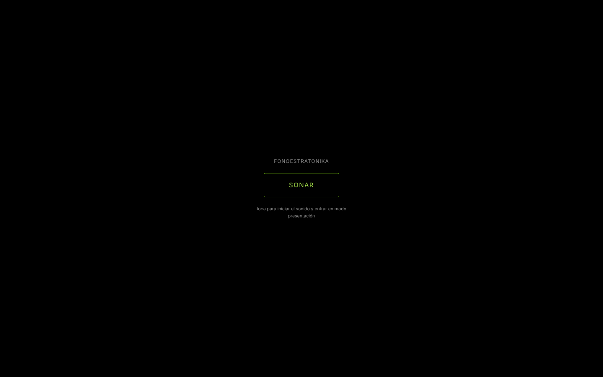<br>Pantalla de inicio / Start screen | 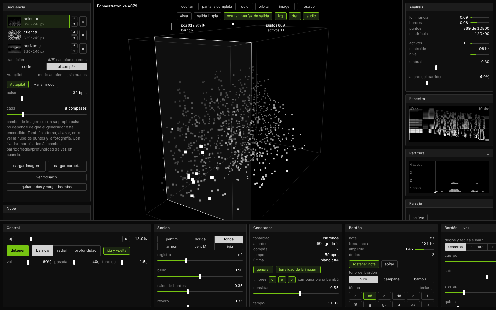<br>Modo edición / Edit mode | 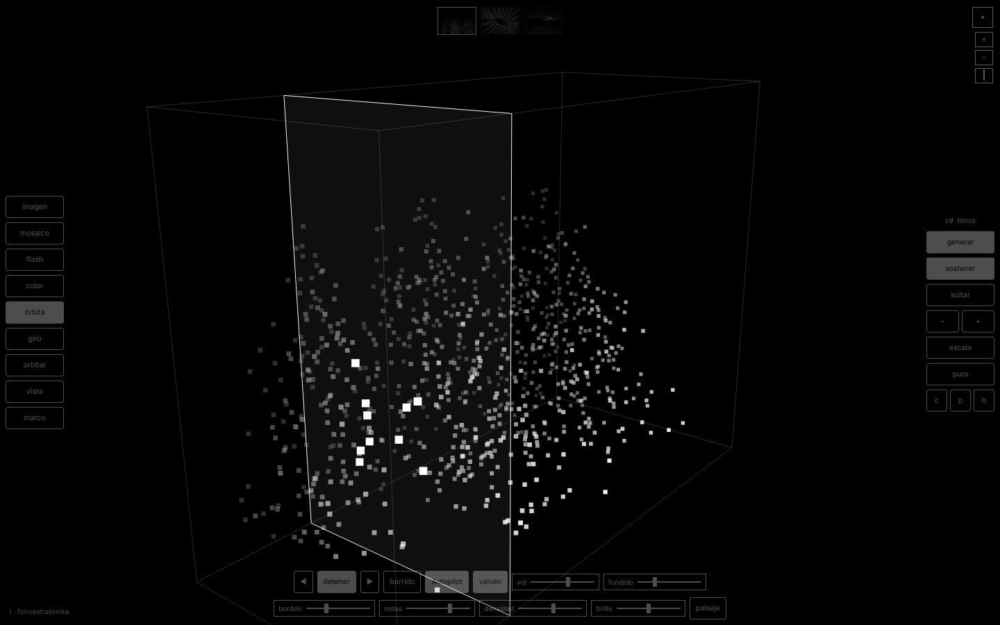<br>HUD mínimo (tecla h) / Minimal HUD (key h) |
| <br>Enlace OSC · MIDI / OSC · MIDI link | <br>Bordón y su voz / Drone and its voice | 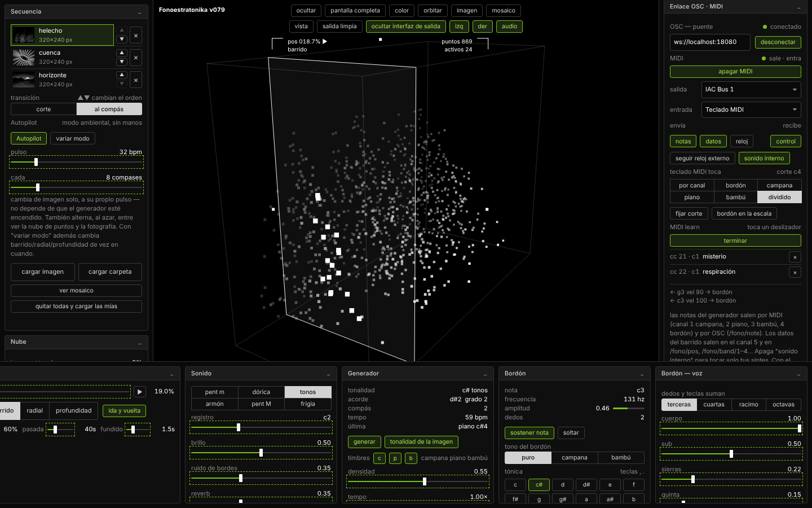<br>MIDI learn |
| 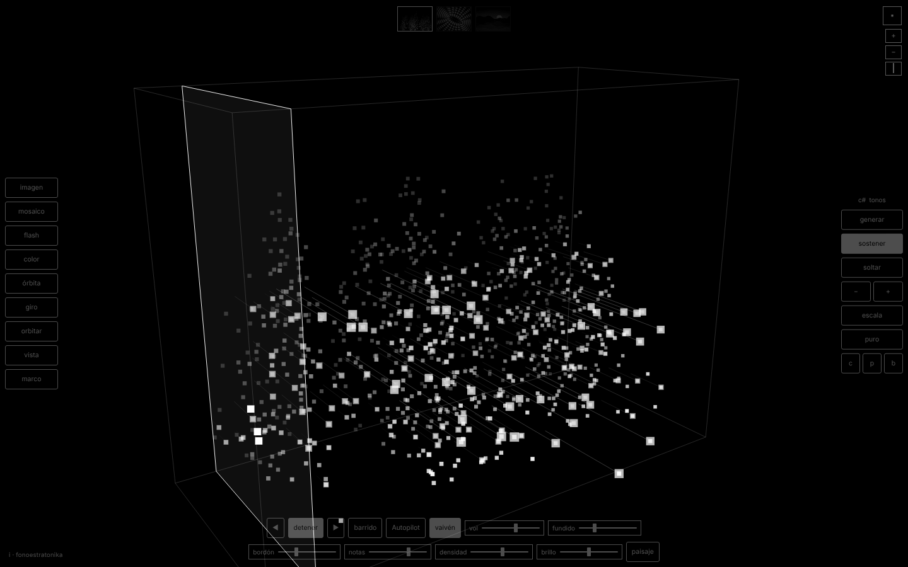<br>Clavos: un acorde levanta sus puntos / Pins: a chord lifts its points | <br>Modo instrumento (v081) / Instrument mode (v081) | 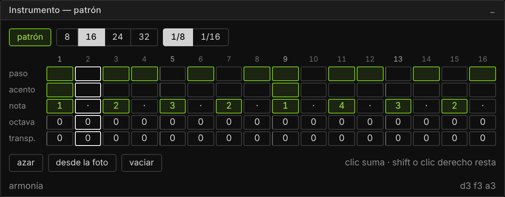<br>Patrón y armonía desde el teclado / Pattern and keyboard harmony |
| 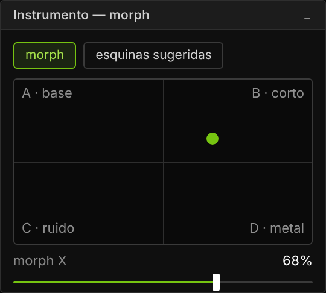<br>Pad de morph XY / XY morph pad | 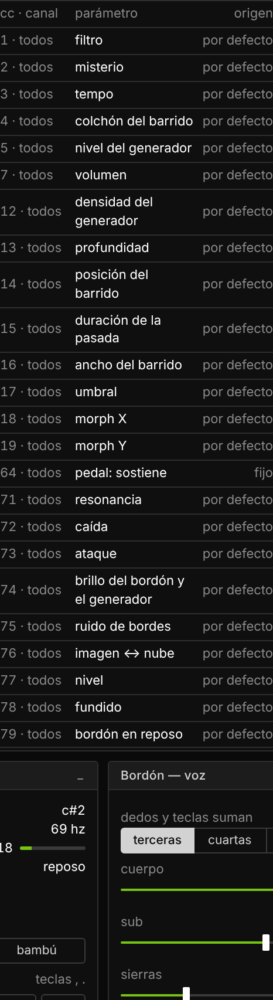<br>Tabla completa de CC / Full CC table | 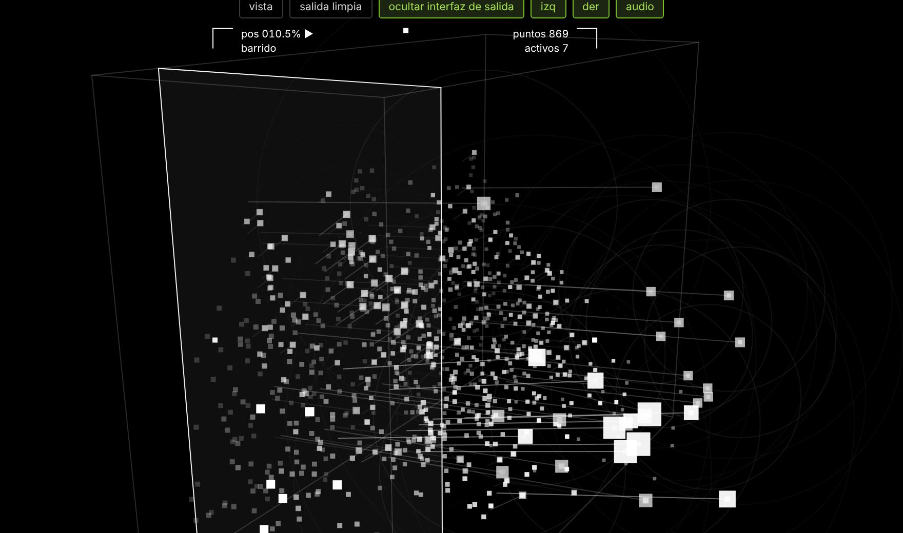<br>La nube escucha (v082) / The cloud listens (v082) |
| 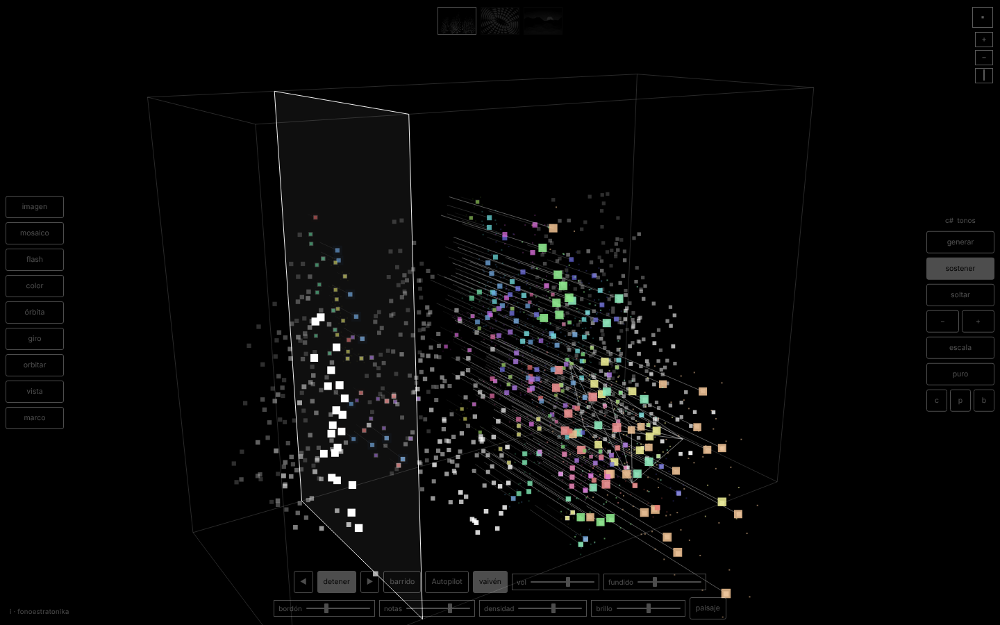<br>Armonía y color por nota (v083) / Harmony and colour by note (v083) | 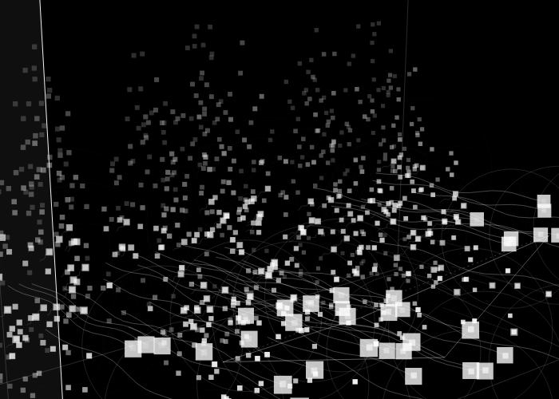<br>Extensiones que ondulan al bajar (v084) / Extensions waving on release (v084) | |

## Estilo

La interfaz sigue el skill [`alchemy-ui`](skills/alchemy-ui/SKILL.md) (tokens y componentes reutilizables en `skills/alchemy-ui/`).

## Versión

v084: ondas, las extensiones de los clavos ondulan al bajar y la velocity decide la velocidad (idea de Maximiliano Wille).
v083: une las dos líneas de trabajo (modo instrumento y la nube escucha) y suma armonía: líneas entre zonas, cohesión y temblor según consonancia, tensión por OSC y CC 34, color por nota opcional.
v082: la nube escucha — reparto «teclado», velocity en Z, intensidad en Y, pitch bend y aftertouch, subestructuras por timbre, granularidad por brillo y dispersión por reverb.
v081: modo instrumento — morph XY, el teclado manda la armonía, patrón tipo arpegiador, tempo fijo, tabla MIDI y set en archivo (a partir de una idea de Maximiliano Wille con FM8).
v080: clavos (cada nota levanta sus puntos de la nube; idea de Maximiliano Wille).
v079: teclado MIDI (bordón polifónico, dividido, pedal, pitch bend, aftertouch, MIDI learn) y voz del bordón abierta.
v078: enlace OSC · MIDI (envía y recibe) y puente OSC.

---

## English

A web artefact from the **Alchemy of Meaning (Alquimia del Significado)** collection. It turns photographs into a 3D point cloud and reads it with a sweep that generates sound. Luminosity, edges, colour and position become notes, timbres, a continuous drone and a live spectrum. It can run unattended (Autopilot) as a permanent installation, or be played as an instrument by touch, with a MIDI keyboard, or from Isadora and TouchDesigner over OSC.

It premiered at the Baja Rare symposium on rare and endemic flora of the peninsula, in Loreto, Baja California Sur.

### How it works

**1. The photo becomes data.** Each image is reduced to a grid of about 120 × 80 points, measuring light, edge strength and colour. Five global features come from the whole image: dominant hue, saturation, mean light, contrast and amount of edges. They form a **seed**, so the same photo always produces the same music.

**2. Cloud and sweep.** Lit points rise in depth according to their brightness and form the cloud. A plane crosses it side to side, as a ring from the centre, or through depth. What it touches is split into 24 bands, low to high, sounding as a continuous additive bed. Edges under the plane add filtered noise.

**3. Procedural notes.** The generator does not depend on the sweep: it has its own clock, and the photo shapes that clock.
- **Key:** hue picks the tonic among the 12 notes. Light picks the scale: whole-tone when desaturated; Phrygian when very dark; minor pentatonic when dark; Dorian at mid light; major pentatonic when bright.
- **Progression:** the seed generates 4 chords, stepping 1 to 5 scale degrees at a time. Contrast decides whether those steps tend to be short or long.
- **Tempo:** comes from the edges, from about 40 bpm for a smooth photo to about 110 for a highly textured one. Each step is an eighth note and 8 steps make a bar. At the start of each bar the piano plays the chord root.
- **Which point sounds:** each step picks a point of the image with a golden-ratio sequence, so the whole photo is visited without repeating or clustering.
- **Sound or silence:** the chance rises with the point's light, on strong beats (steps 1 and 5) and with density. Every fourth bar thins out, like a breath.
- **Timbre and pitch:** a point on an edge sounds as bamboo. Otherwise it is a bell in the upper half and piano in the lower half. Pitch is a note of the current chord, higher the higher the point. Velocity follows the point's light and panning its horizontal position.
- **Mystery:** now and then a tension note appears, a minor second or a tritone. It happens more often in dark photos and always on the bell.

All three timbres are synthesized live, without samples. The bell uses inharmonic partials with a long tail, the piano soft FM with a hammer strike, and the bamboo a noise burst through a tuned resonator.

**Pins (v080).** An idea by Maximiliano Wille. The 88 piano keys are shared out equally among the photo's points. When a note sounds, whether from the generator, the keyboard or the drone, its points rise toward the viewer on a thin line, grow and light up, like a pin-art toy taking the mould of a hand. There are three layouts:
- **altura** (height): low at the bottom, high at the top.
- **luz** (light): low in the dark areas, high in the bright ones.
- **disperso** (scattered): each key sprinkled across the whole image.

In height and light layouts each note also nudges its neighbours, like finger pressure. Bells last longer than piano and bamboo, and the drone holds its pins while it sounds. Set it in the **Nube** window: pins, layout, pin height and tail. "Marcas" brings back the old circles.

**4. The drone.** A sustained voice of seven oscillators: body, sub, detuned saws, fifth and octave, through a filter that breathes with a slow LFO. You play it on the image, with pitch on the vertical axis and volume and brightness on the horizontal. Each extra finger adds a degree (thirds, fourths, cluster or octaves). It also plays from a MIDI keyboard, up to 4 notes at once. The **Bordón — voz** window opens its whole mix, filter, breathing, attack and release.

**5. Landscape.** An optional layer of wind, waves, tide, birds and desert, also synthesized. It is seeded from each photo's colour and texture: blues bring water, greens birds and warm tones desert.

**6. Film.** Photos go through an HP5-style black-and-white treatment with adjustable grain, contrast and vignette. Analysis runs on that version.

### Usage

1. Open `index.html` in a browser (or the hosted version) and press **sonar** (play). This starts audio and lands in edit mode with all windows.
2. Controls: side windows (sequence, analysis, spectrum, score, link) and a bottom dock (control, sound, generator, drone, drone voice).
3. Handy keys: `space` play/stop, `h` hide the interface, `f` fullscreen, `←` `→` change photo, `g` generator, `m` sweep mode.
4. **Autopilot** is on by default: it alternates images and modes hands-free.

### Your photos

Copy your `.jpg`/`.png` files into `fotos/` and list one filename per line in `fotos/listado.txt` (lines starting with `#` are ignored). With an empty list the app uses 3 generated sample images. The "quitar todas y cargar las mías" button replaces the current gallery.

### MIDI keyboard and controllers (v079)

In Chrome or Edge, open the **Enlace OSC · MIDI** window → **activar MIDI** and pick your keyboard as input.
- **Split** (default): below C4 plays the drone; above, bamboo, piano and bell by octave. "fijar corte" moves the split point.
- **Polyphonic drone:** up to 4 held notes, in free tuning or snapped to the scale.
- **Expression:** sustain pedal holds, pitch bend gives ±2 semitones and aftertouch opens the filter.
- **Knobs:** the default map follows General MIDI (1 filter, 71 resonance, 72 release, 73 attack, 74 brightness, 91 reverb). With **aprender** (learn), touch a slider and move any knob to assign it.

### OSC (Isadora, TouchDesigner, Max) (v078)

Fonoestratonika sends its notes, drone, sweep data and each photo's features, and receives control and clock. Browsers can't speak UDP, so OSC goes through a tiny dependency-free bridge (Node.js 18+):

```
node puente/puente.js --out 127.0.0.1:1234 --in 9001
```

Then open `http://localhost:8080`. The bridge serves the app and accepts several targets, such as a Tailscale IP for remote play. The full address, CC and channel map is in [`puente/LEEME.md`](puente/LEEME.md) (Spanish).

### Instrument mode (v081)

Made so a musician such as Maximiliano Wille can play Fonoestratonika on stage, inspired by FM8's Easy/Morph, arpeggiator and controller table. Two new dock windows:

- **Instrument — morph:** an XY pad mixing four corner sounds (drone voice, density, tempo, mystery, brightness, edge noise, reverb, cloud and pins). "Suggested corners" builds four variants of the current sound; A–D store the current sound in a corner. X/Y on CC 18/19, MIDI learn and OSC (`/fono/mx`, `/fono/my`, `/fono/corner 0–3`, `/fono/morph`).
- **Instrument — pattern:** *keyboard leads* — below the split (or the whole keyboard outside split mode) you play a chord and the generator improvises or arpeggiates over those notes; with no keys it waits, like an arpeggiator; *hold*, *key sync*, *also to the drone*. *Pattern*: 8–32 steps at 1/8 or 1/16 with step, accent, note (chord tone 1–4 or "·" = the photo decides), octave (−2…+2) and transpose (0–11). *Fixed tempo* 30–200 bpm (below 30 = photo tempo). OSC: `/fono/harm`, `/fono/hold`, `/fono/hnote note vel`, `/fono/hclear`, `/fono/pat`, `/fono/patLen`, `/fono/bpmFix`.
- **The cloud listens (v082):** a "keyboard" pin layout (low notes left, high right); velocity pushes pins forward (Z), intensity lifts them while they sound (Y, "lift" slider), pitch bend shifts them sideways, aftertouch brightens them; bell opens rings, bamboo crumbles into dust, the drone breathes with its LFO; brightness makes pins grainier and reverb spreads them. The cloud stays white. Toggles in the **Cloud** window or `/fono/listen`, `/fono/pinSub`.
- **Harmony (v083):** when several notes sound together, lines join their zones. Consonant intervals give firm lines and draw the zones in; clashing ones open them, make them tremble and dash the line. Harmonic tension (0–1) goes out on `/fono/tension` and CC 34. Optional colour by note follows the circle of fifths. `/fono/pinHarm`, `/fono/pinColor`.
- **Waves (v084):** an idea by Maximiliano Wille. Each pin's extension undulates while the pin falls back (the note's release). Note velocity sets the wave speed; base and tip stay still. Choose straight, waves on release or always, plus amount, in the **Nube** window or via `/fono/pinWave 0–2` and `/fono/pinWaveA`.
- **MIDI table and set:** in the OSC · MIDI link window, "full table" lists every CC; "save set" downloads a `.json` with MIDI learn, keyboard mode, split, morph corners, pattern and the whole sound; "load set" restores it.

### Run it

Single file, no dependencies or build step. To auto-load `fotos/`, serve it over HTTP, with the bridge or with:

```
python3 -m http.server 8000
```

then open `http://localhost:8000/`. It works offline (Inter loads from Google Fonts only when online; otherwise Arial).

### Style

The UI follows the [`alchemy-ui`](skills/alchemy-ui/SKILL.md) skill (reusable tokens and components in `skills/alchemy-ui/`).

### Version

v084: waves, pin extensions undulate on release with speed set by velocity (idea by Maximiliano Wille).
v083: merges both lines of work (instrument mode and the listening cloud) and adds harmony: lines between zones, cohesion and tremble by consonance, tension over OSC and CC 34, optional colour by note.
v082: the cloud listens — keyboard layout, velocity on Z, intensity on Y, pitch bend and aftertouch, per-timbre substructures, grain from brightness and spread from reverb.
v081: instrument mode — XY morph, keyboard-led harmony, arpeggiator-style pattern, fixed tempo, MIDI table and set file (from an idea by Maximiliano Wille with FM8).
v080: pins (each note lifts its points in the cloud; idea by Maximiliano Wille).
v079: MIDI keyboard (polyphonic drone, split, sustain, pitch bend, aftertouch, MIDI learn) and open drone voice.
v078: OSC · MIDI link (send and receive) and OSC bridge.

---

## Créditos / Credits

Diseño, investigación y desarrollo: Héctor Cruz Juárez — https://hectorcruz.com.mx  
Colección Alchemy of Meaning.

Licencia GPL-3.0-or-later (ver `LICENSE`). / GPL-3.0-or-later license (see `LICENSE`).
